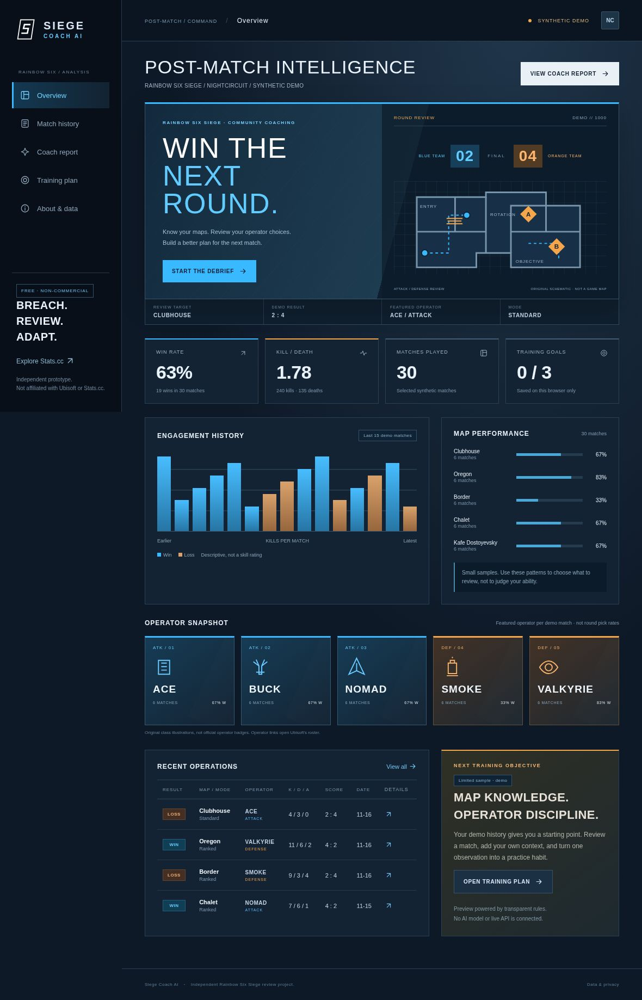
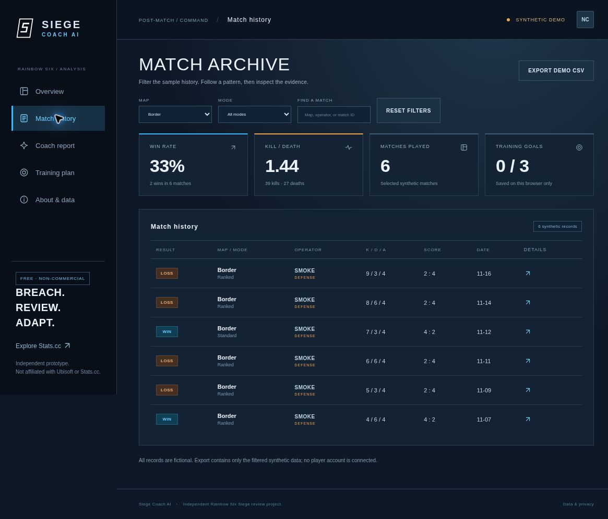
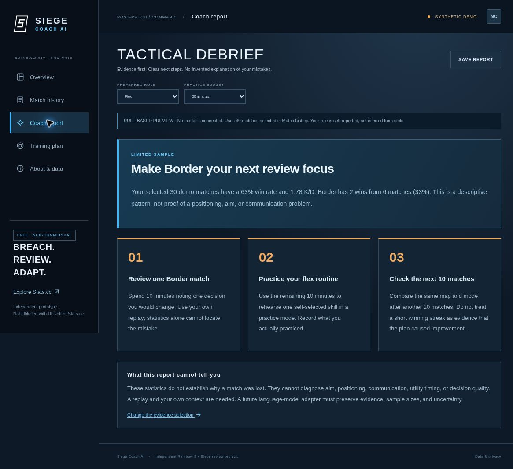
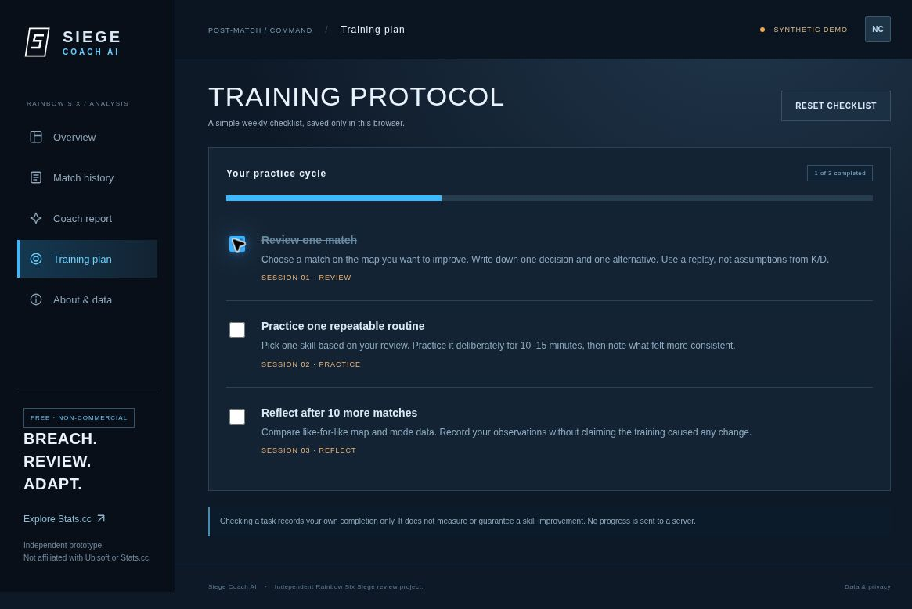
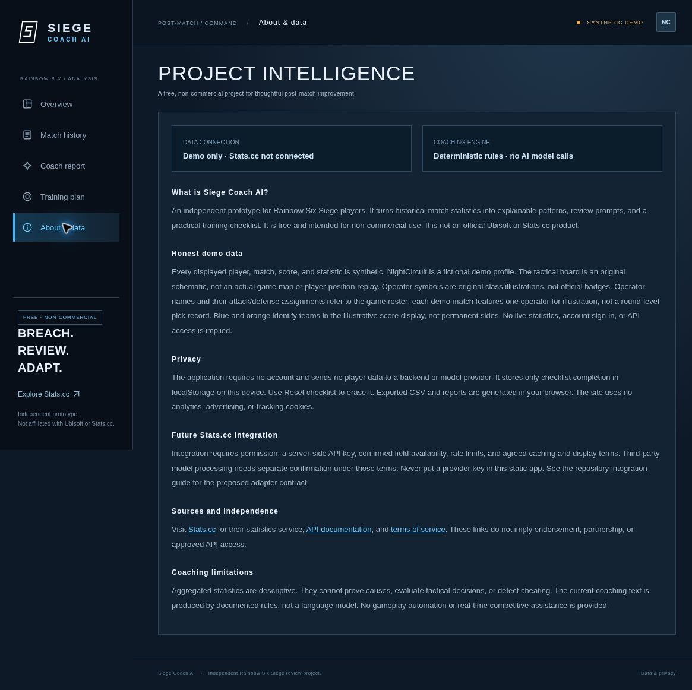

# Siege Coach AI

**Win the next round. Review the last one.**

A free, non-commercial Rainbow Six Siege post-match coaching prototype. Explore match history, understand descriptive trends, and build a small, repeatable training habit.

> **Project status: functional synthetic-data demo.** No Stats.cc API key, player account, backend, or language model is connected. Coaching is currently generated by transparent deterministic rules. All displayed matches and the “NightCircuit” profile are fictional. This is an independent project, not endorsed by Ubisoft or Stats.cc.

## Preview

Actual screenshots captured from the running synthetic-data demo through a supported browser preview. These are application captures, not generated design mockups.

### Performance overview



### Match history



### Evidence-led coach report



### Training plan



### Data transparency



## Siege-specific visual identity

The interface is a post-match review desk rather than a generic business dashboard: blue/orange team-score HUD, hard-edged panels, round-score typography, a schematic A/B objective board, and operator cards. Match records use recognizable maps (Clubhouse, Oregon, Border, Chalet, Kafe Dostoyevsky) and operators (Ace, Smoke, Buck, Valkyrie, Nomad). The operator cards link to their official Ubisoft roster pages.

All match outcomes remain synthetic. The schematic is original artwork, not a real map layout or replay. Class symbols are original illustrations, not official operator badges. An operator shown in a demo match is a featured operator for illustration, not a full round-by-round selection log. Blue/orange identify teams in the score HUD, not permanently assigned attack/defense sides. No Ubisoft game imagery or logo is bundled or copied.

## What works today

- **Overview:** win rate, aggregate K/D, match count, map breakdown, and recent-match chart.
- **Match history:** map/mode filters, text search, empty states, match details, and filtered CSV export.
- **Coach report:** selected-match evidence, self-reported role and practice budget, sample-size caveats, and downloadable text report.
- **Training plan:** three-step checklist with browser-local persistence and reset.
- **Data transparency:** an in-app page explaining synthetic data, privacy, limits, and proposed integration.
- Responsive desktop/mobile layout, keyboard-accessible controls, native dialog dismissal, and hash-based routes for static hosting.

No accounts, advertising, analytics, payments, external runtime dependencies, or API requests are used. The only stored application data is checklist completion in this browser's localStorage. Reset checklist removes that state. Hosting providers may independently log ordinary HTTP requests.

## Run locally

Requires Python 3 for the development server. Node.js 20+ is only needed for checks.

```bash
git clone https://github.com/sqy941013/siege-coach-ai.git
cd siege-coach-ai
python3 -m http.server 4173
```

Open <http://localhost:4173>. Use an HTTP server rather than opening `index.html` as a `file://` URL, because the application uses JavaScript modules.

Alternatively:

```bash
npm start
```

No `npm install` is required to run the app or unit tests.

## Test

```bash
npm test
npm run check
```

Unit coverage includes deterministic fixtures, summary arithmetic, empty and zero-death data, group reconciliation, coaching evidence limits, and budget personalization. Browser checks are recorded in [docs/QA.md](docs/QA.md).

## Static deployment

This project needs no build step. Publish `index.html` and `src/` to any static host. Relative asset paths and hash routes support a GitHub Pages project subdirectory.

A manual GitHub Pages workflow is included in `.github/workflows/pages.yml`. After enabling Pages with **GitHub Actions** as its source, run **Deploy static demo to GitHub Pages** from Actions. This does not enable a provider API or create a backend. Deployment is not automatic on push.

## Architecture

```text
index.html                Accessible shell and native match dialog
src/styles.css            Responsive visual system
src/analytics.js           Synthetic fixture and pure analytics/coaching rules
src/app.js                 Routes, rendering, filters, exports, local checklist
src/providers.js           Explicit provider boundaries for future integration
tests/*.test.js            Dependency-free analytics and icon regression tests
docs/INTEGRATION.md        Provider approval gates and future server design
docs/screenshots/          Actual application screenshots
```

The interface is intentionally lightweight and easy to audit. The fixture and calculations are separate from rendering. The current rules identify an observed map pattern, quote its evidence, and recommend a review cycle; they do **not** diagnose the cause of a loss.

## Stats.cc and AI roadmap

1. Validate the product using clearly labeled synthetic data.
2. Obtain written approval for the intended API use and confirm fields, quotas, retention, display and processing terms.
3. Implement a server-side provider adapter, consent/deletion controls, and rate-limited data ingestion.
4. Optionally connect a model to approved aggregate data with output validation and a rule-based fallback.

See the [integration plan](docs/INTEGRATION.md). Keys must never appear in the client, a public repository, screenshots, or frontend environment variables. API documentation availability does not constitute access approval.

## Limitations

- Demo dates and records are fixed, not live.
- K/D is total kills divided by total deaths, not an average of per-match ratios.
- Map sample sizes are small. The app is not a validated skill estimator.
- Aggregate stats cannot establish positioning, aim, communication or tactical mistakes.
- No replay parsing, real-time assistance, account linking, cheating detection, or actual LLM analysis is implemented.
- Real provider records may be incomplete; a production importer must handle null fields and coverage before reusing these demo calculations.

## Project purpose and rights

The website is intended to remain free and non-commercial. No software license has been selected yet; public source visibility does not grant reuse rights beyond applicable law. Third-party names belong to their respective owners. No game artwork, logos, player data, or provider datasets are bundled. The tactical schematic, class illustrations, and brand mark are original SVG artwork and do not reproduce official maps, operator badges, or Ubisoft logos.
